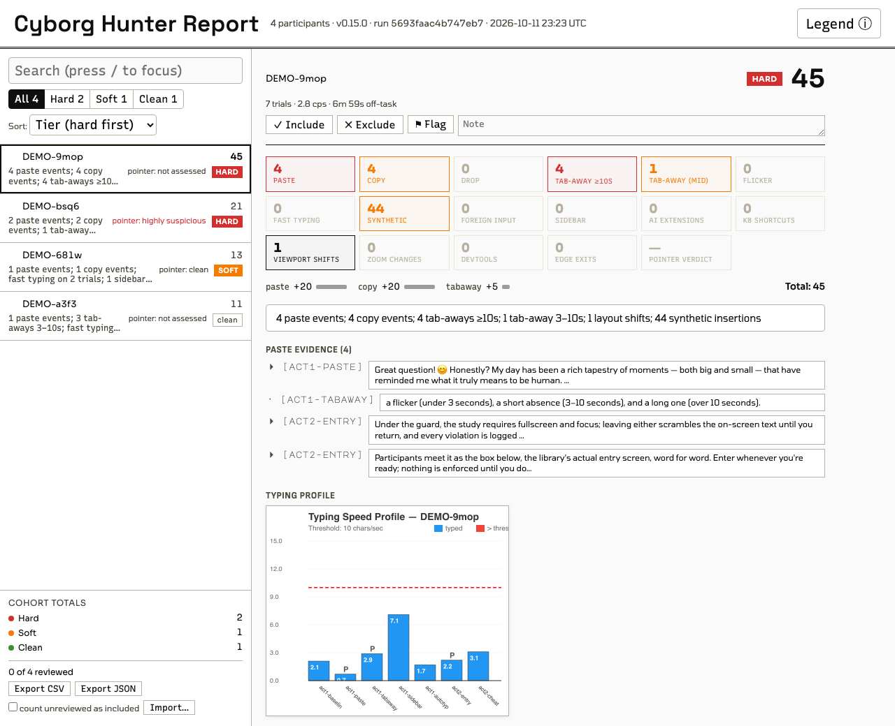

# CLI Reference

> [!NOTE]
> AI generated writing.

What a successful run looks like — the HTML report for the bundled dataset of four sessions recorded on the demo ([worked-example.md](worked-example.md)):



## Commands

### `cyborg-hunter report`

Generate the integrity report from a directory of participant data files.

```bash
cyborg-hunter report [options]
```

Running `cyborg-hunter` with no subcommand defaults to `report`.

**Options:**

| Flag | Description |
|---|---|
| `--config <path>` / `--config-file <path>` | Config file path (default: `./cyborg-hunter.config.json`) |
| `--data <path>` / `--data-dir <path>` | Override `dataDir` |
| `--output <path>` / `--output-dir <path>` | Override `outputDir` |
| `--participant-id-field <name>` | Override `participantIdField` (e.g. `subject_ID` for jsPsych; dot-paths like `metadata.sessionId` supported; lab.js data keeps the default, see [labjs.md](labjs.md#saving-and-reading-the-data)) |
| `--file-pattern <glob>` | Override `filePattern` |
| `--integrity-field <name>` | Override `integrityField` |
| `--session-integrity-path <path>` | Dotted path to the session-level integrity object (e.g. `payload.cyborgHunter`) |
| `--qualtrics-field <name>` | Override `qualtricsField`, the Qualtrics export column holding the payload (default `__js_cyborg_hunter`) |
| `--participant <id>` | Filter to a single participant, by the key the report shows (for lab.js data keyed by the study's own `participantId`, that id, not ch-labjs.js's) |
| `--no-visuals` | Skip image generation (no `canvas` package required) |
| `--pseudonymize` | Replace participant IDs with stable codes in every output, for sharing ([configuration.md](configuration.md#output)) |
| `--pseudonym-key-file <path>` | Where the code-to-ID key is kept (default `./cyborg-hunter-pseudonyms.csv`; never inside the output folder) |

Unknown flags exit with an error rather than silently falling back to whatever config file is in cwd (fixed in v0.3.0).

Qualtrics exports are detected by their header rows; one participant per response. A `.csv` whose first header row has `ResponseId` (`ResponseID` in a legacy export) and `__js_cyborg_hunter` (or `cyborg_hunter`, or the column named by `qualtricsField`), plus one sign that Qualtrics wrote it (a second Qualtrics column such as `StartDate` or `RecordedDate`, the `ImportId` header row, or a first non-empty payload cell written by `ch-qualtrics.js`), is read row by row, each response's payload cell as one participant. Rows with an empty cell are counted in one warning, a cell that is not JSON is reported under its response, and a payload with no linkable participant ID takes the row's `ResponseId`. Every other CSV is still one participant per file.

Warnings found while reading the data (a file without session data, an unresolved participant ID, a Qualtrics export's empty or malformed responses) are printed to stderr after the `Found N participants` line: one line per warning, file-level ones first, at most 20, then a count of the rest. stdout and the output files do not include them.

### `cyborg-hunter init`

Generate a starter config file in the current directory.

```bash
cyborg-hunter init
```

Refuses to overwrite an existing `cyborg-hunter.config.json`.

### Replay artifacts

**Recordings in your data.** Under the one-line setup the session recording
arrives inside the data you saved, in pieces: `cyborgHunterReplay` (and
`cyborgHunterReplayFinal` on the last row) in jsPsych and lab.js rows, JSON or
CSV, and on pages without a framework a saved `cyborgHunterReplay` POST field
or the `cyborgHunterReplay` of `CyborgHunter.data()`, under any file name. The
CLI finds the pieces by their content, puts each recording back together and
attaches it to the participant whose data file held it; pieces whose header
names another participant are reported and attached to no one. A file
holding pieces alone (a saved `cyborgHunterReplay` field) attaches by the
`participant_id` inside it. Rows a save trial saved before
the session ended give the recording up to that point; pieces missing in
between are left out and reported; without its first piece a recording cannot
be rebuilt, which is reported too. A participant's recordings that follow one
another in time (one per page, or a reload) are joined into one replay. A
recording found outside the participant's own data joins only when it was
recorded in a browser (`user_agent`) their own data shows; one from another
browser is left out with a warning, and when their own data holds no
recording to tell, recordings from different browsers are not attached at all;
recordings that overlap in time are two sessions, and the latest is shown with
a warning. The same recording found both in the rows and as a saved file
counts once, and the copy from the participant's own data is kept.

**Files.** `<pid>-replay-<epoch>.json[.gz]` files are picked up automatically from
`dataDir` (or `replayDir` when set) and rendered as per-participant
**Session replay** sections. Ownership is verified against the recording's
embedded `participant_id`; corrupt artifacts are reported, never fatal;
`report` prints the total size of emitted `replay/` assets. A `.gz` file
that would decompress to more than 256 MB is not read and is reported (a
participant-supplied file can be a "gzip bomb"), and so is a participant file
larger than 256 MB as stored.

Recordings from other producers are accepted too, since SessionRecording v2 is
not a Cyborg Hunter format:

- **Any filename.** A file that is structurally a v2 recording is recognised by
  its contents, whatever it is called (`session.json`, a dated download). Those
  attach **only** by the `participant_id` inside them — there is no filename to
  verify against, so one naming no participant in the dataset is reported and
  left unattached rather than guessed at.
- **jsPsych v1 recordings convert on the way in.** The player is v2-only, so a
  `schema_version: 1` jsPsych recording is converted in memory by
  `tools/convert/jspsych-v1-to-v2.mjs` before it reaches the report. The file on
  disk is never modified, and the notice names the tool version and the source
  hash that reproduce the conversion. A recording the converter refuses (it
  never fills in a missing field or renumbers a trial) is reported with the
  refusal's own remedy, and the rest of the cohort still renders. jsPsych v1
  records no `participant_id`, so these must use the `<pid>-replay-<epoch>.json`
  name to attach.

**Styled replays from your experiment's files.** A dom-tier recording keeps
the URL of every external stylesheet and image; when the experiment server
is gone (or the report must not fetch anything), point `assetsDir` (or
`--assets-dir <path>`) at a folder with those files. They are matched by URL
path suffix, then filename, and inlined into `replay/*.replay.js`; the replay
section states, for example, "Experiment assets: 2 of 3 stylesheets matched
(missing: fonts.css)". A missing or unreadable folder is an error. See
[docs/configuration.md → Data source](configuration.md#data-source).

## Output structure

```
cyborg-hunter-report/
├── index.html           # landing page (open this)
├── summary.csv          # one row per participant, every signal as a column
├── triage.md            # ranked markdown table with a one-line "why flagged"
├── event-log.csv        # chronological events (copy/paste/drop/synthetic/tabAway)
├── extensions.csv       # AI-extension + sidebar detections, one row per participant × detection
├── score-weights.json   # the triage-score weights this report used (defaults or scoreWeights)
├── cursor-limits.json   # the constants the cursor section judged with, their meanings, and the verdicts over the cohort
├── typing-limits.json   # the constants the typing section judged with, their meanings, where the rhythm and the rate came from, and the verdicts over the cohort
├── replay/              # each participant's whole session recording, loaded by index.html (most sensitive output)
│   └── <participantId>.replay.js
└── images/              # canvas-rendered visuals (skipped if canvas missing)
    ├── trajectories_<participantId>.png      # per-trial mouse paths
    ├── session_timeline_<participantId>.png  # session-wide trials, text input, tab-away / sidebar / guard timeline
    └── typing_profile_<participantId>.png    # typing speed per trial, on the timeline's time axis
```

Every output is keyed by participant ID, which under the one-line setup is the
platform's (Prolific, MTurk). `index.html` carries pasted texts, `event-log.csv`
every pasted and dropped text (a synthetic insertion's row has no text: the monitor records only its length, which the log does not show), `summary.csv` the
honeypot's free-text answer, and `replay/` the whole recordings (typed text
included). Treat the folder as raw, identifiable data; to share it, run
with `--pseudonymize`, which replaces every ID with a code and keeps the key
to them outside the folder (it does not remove identifying content such as
pasted text). The CLI writes into
`outputDir` without deleting what an earlier run left there, so a participant
you later exclude keeps their old files until you empty the folder.

**Network.** The CLI reads and writes local files only, with one exception:
once a day, `report` asks the npm registry for the latest version
(`https://registry.npmjs.org/cyborg-hunter/latest`) to tell you about an update.
The request carries no data from your study; the registry sees your IP address.
The answer is kept for a day in `~/.cache/cyborg-hunter/update-check.json`.
Set `NO_UPDATE_NOTIFIER=1` (or run with `CI` set) to turn it off. Opening a
`dom`-tier replay in `index.html` loads the recorded page's images, fonts and,
unless you untick the box, its external stylesheets from their own addresses
([Viewing replays](using-cyborg-hunter.md#viewing-replays)).

## Output files

### `index.html`

Landing page (it needs the `images/` and `replay/` folders beside it):

- A rail of participants with a search box (every word must match: part of an id or of the triage reason, or the start of a word for a signal the participant has, such as `mous` for a suspicious pointer verdict or `cut pan` for a copy or cut and a sidebar event), the tier block (All / Hard / Soft / Clean, with counts; `HARD*` rows count as hard), the label block (All / Unmarked / Include / Exclude / Flag), and five sorts: **Score ↓** (the default), **Tier, then score** (the order of `triage.md`), **Pointer verdict ↓**, **Typing verdict ↓** and **ID** ([Finding participants in the rail](using-cyborg-hunter.md#finding-participants-in-the-rail))
- **Weights…** in the top bar: the score weights, caps and **Hard at** counts as sliders and boxes (a participant whose count reaches its Hard at count becomes `HARD*`; the library's tier is kept). The list re-scores, re-tiers and re-sorts as you type. The report's files and its annotation exports keep the weights the report was built with; **Copy config** gives the lines for the config file
- Per-participant detail sections with linked images and signal summaries
- In each participant's detail, a Typing dynamics section (the typing verdict, its tells, every judged text field and the typing rate) above the Cursor dynamics section

Images are linked from `images/`, not base64-embedded — keeps the HTML readable and the page lightweight.

### `summary.csv`

One row per participant:

| Column | Description |
|---|---|
| `participantId` | Participant identifier |
| `trialCount` | Number of monitored trials |
| `triageScore` | Combined triage score (see [Triage scoring](#triage-scoring) below) |
| `hardTriggered` | `YES` / `no` — did any hard signal fire |
| `triageReason` | One-line summary of why this participant ranked where they did |
| `totalPasteEvents` | Total paste events across all trials |
| `totalCopyEvents` | Total copy events across all trials |
| `totalTabAways` | Total tab-away events |
| `meanTypingSpeed` | Mean of the saved chars/sec across trials, 0 for a trial with none (for data before 0.17, the old formula's numbers; the Typing dynamics section and `trialsWithFastTyping` use the corrected rate where they can) |
| `trialsWithFastTyping` | Trials typed faster than the participant's cps threshold. From 0.17, trials of 20 or more edits, or of the participant's own `thresholds.typingMinEdits`, which the session report saves; for older data, by the rate recomputed from the trial's saved edit times or from a session recording that keeps the page (`dom` tier), else by the saved rate (`typingRateSource` says which) |
| `meanMouseEvents` | Mean mouse events per trial |
| `totalSoftScore` | Accumulated soft score |
| `sidebar_event_count` | Sidebar-gap detections (session-level) |
| `ai_extensions` | AI-extension selectors matched (semicolon-joined) |
| `keyboard_shortcut_count` | DevTools-hotkey presses (Ctrl/Cmd+Shift+I/J/C, F12) |
| `layout_shift_count` | Layout-compression events |
| `zoom_change_count` | Inferred zoom level changes |
| `dev_tools_event_count` | Reserved column; currently always 0 (DevTools-open is recorded under `keyboard_shortcut_count`) |
| `authoritative_soft_score` | Soft score from `getSessionReport()` (preferred over the per-trial sum) |
| `honeypot_ai_use` | Three states: `YES` = participant ticked the visible-bait "I used AI" checkbox; `no` = the honeypot was present but the box was left unticked (negative evidence); empty = the honeypot extension wasn't used for this participant at all |
| `honeypot_ai_report` | Free-text the participant typed into the honeypot's "what did you use?" box (empty if none) |
| `cursorReason` | Why the session's pointer verdict is `not assessed`: `not collected` (with `(recorded with <version>)` when the data names one), `no cursor stream (touch device)`, `no cursor stream (no pointer events)`, `device facts and click provenance not recorded (library before 0.14)`, or `only K of N first pointer clicks had a known position before them (the no-path rule needs 4)` (`click` when N is 1); empty when the session is assessed, including a session with no cursor stream that its automation flag makes highly suspicious (since 0.14, like every `cursor…` column but `cursorCenteredNear` and `cursorSoftwareRenderer`, from 0.17) |
| `cursorVerdict` | The pointer verdict: `clean`, `suspicious`, `highly suspicious` or `not assessed` |
| `cursorTells` | The tells that decided a suspicious or highly suspicious verdict, `; `-separated: `automation flag`, `untrusted clicks n/N`, `clicks without a path n/N`, `trials clicked without movement n/N`, `centered clicks n/N`; empty otherwise |
| `cursorChecksRecorded` | How many of the four browser-reported checks the data supports: 4 or 3 (a cursor stream and the session's device facts, with or without the software-renderer fact, recorded since 0.17), 2 or 1 (device facts and no cursor stream: the automation flag, and the software renderer when recorded), 0 (no device facts: recorded before 0.14) |
| `cursorFactCount` | Browser-reported checks that fired, 0–3 (one per check, not per event): the automation flag, clicks the page's own scripts dispatched, trials clicked without pointer movement. The software renderer is shown, not counted. Empty without device facts |
| `cursorWebdriver` | `YES` / `no`: the automation flag set by the browser; empty without device facts |
| `cursorUntrustedClicks` | Clicks the page's own scripts dispatched; empty unless the session has a cursor stream and device facts |
| `cursorZeroMoveTrials` | Trials clicked without pointer movement, as `count/trials`; empty unless the session has a cursor stream and device facts |
| `cursorJumpClicks` | Clicks after a pointer jump, as `count/first pointer clicks with a known position before them`; reported, not a tell |
| `cursorNoPathClicks` | Clicks that arrived without a path, as `count/first pointer clicks with a known position before them` (a double-click's later clicks are not first clicks) |
| `cursorCoordinates` | `viewport` (every sample has `cx`, `cy`) or `page` (older data; scrolling can then look like a jump) |
| `cursorStream` | The stream the section read: `core`, the monitor's mouse track |
| `cursorSampleIntervalMs` | Median time between consecutive move samples within a trial, in ms; empty when the track has no such pair |
| `cursorClicks` | Clicks in the mouse track |
| `cursorMovements` | Movements: runs of move samples, ended by a gap longer than 400 ms or by a click; a click with no move before it counts as a movement of its own |
| `cursorMovesPerTrialMedian` | Median number of move samples per trial (depends on the sampling interval) |
| `cursorEfficiencyMedian` | Median efficiency per movement (displacement over path length, 1 for a straight line), three decimals |
| `cursorMaxDeviationPxMedian` | Median of each movement's largest distance from the straight line between its ends, in px, one decimal |
| `cursorCenteredClicks` | Clicks at the exact centre of the control, as `count/qualifying clicks`, read from the session recording (see [`cursor-limits.json`](#cursor-limitsjson)); `touch` for a touch recording, which is not judged; empty without a recording, and for a session without a cursor stream even with one |
| `cursorCenteredNear` | Qualifying clicks within 5 px of the control's centre, as `count/qualifying clicks`; reported, not judged; `touch` for a touch recording; empty without a recording, and for a session without a cursor stream even with one |
| `cursorSoftwareRenderer` | `YES (<family>)` when the browser drew without a graphics card (`swiftshader`, `llvmpipe`, `softpipe`, `microsoft-basic-render`, `mesa-offscreen`), `no`, `no WebGL`, or empty (not recorded: data before 0.17, the switch off, no answer, or, under the one-line setup, a first page or trial that ended before the read: [upgrading.md](upgrading.md#unreleased--from-016)). A device fact: not a tell, not in `cursorFactCount` |
| `deviceMasking` | The device-masking rules that fired, space-separated: `R1` (a pixel ratio no browser produces), `R2` (a pixel ratio that stays fixed through a page zoom; not applied to Safari), `R3a` (a window larger than the screen it reports by more than 3% + 20 px; not applied to Firefox when the browser is known, nor with a second monitor in the log). Empty when none fired or the session has no window log. Read from `session.windowPositions` and the recording's browser line; nothing new is collected. Not evidence of AI use ([interpreting-signals.md](interpreting-signals.md#signals-that-never-score)) |
| `typingVerdict` | The typing verdict: `clean`, `suspicious`, `highly suspicious` or `not assessed` |
| `typingTells` | The tells behind a suspicious or highly suspicious verdict, `; `-separated: `median gap <n> ms` (keys faster than a person types), `gap variation <v>` (keys too even); empty otherwise |
| `typingFieldsJudged` | Text fields with 20 or more key gaps that were judged. Empty when the session's typing rhythm was not recorded: no rhythm summaries (library before 0.17, or `signals.typingRhythm` off), and either no recording that matches a judged trial or a `trace`-tier recording whose judged trials hold typed keys (it does not say which field each key went to). `0` when the rhythm was recorded but no field reached 20 key gaps; a `trace`-tier recording whose judged trials hold no typed keys also gives `0` |
| `typingFastestMedianMs` | The smallest median gap among the judged fields, in ms (one decimal); empty when none was judged |
| `typingLowestCv` | The smallest gap variation among the judged fields (three decimals); empty when none was judged |
| `typingRateSource` | Where the typing rates behind `trialsWithFastTyping` came from: `library` (0.17 on: (edits − 1) per second, from 20 edits or the participant's own `thresholds.typingMinEdits`), `edit times` (older data saved with keystroke dynamics or `collectForPostHoc.fullKeystrokeTimestamps` on: recomputed the same way from the trial's saved edit times), `recording` (older data: recomputed the same way from the trial's edits in a session recording that keeps the page, `dom` tier), `old formula` (older data with neither saved edit times nor recorded edits, which includes every trial of a `trace`-tier recording whose edit times were not saved: the saved rate, edits over the time, from 2 edits). With several, the weakest any judged trial used (`old formula` < `recording` < `edit times` < `library`); with no judged trial, the strongest available. It is the rate's source, not the rhythm's: data recorded with 0.17 and `signals.typingRhythm` off can read `library` here while its typing rhythm is not recorded |
| `reportTier` | The report's tier, the last column (since 0.17): `hard`, `hard*` (a soft or clean participant that a signal's `hardAt` count moved into the hard tier, [configuration.md](configuration.md#report-hard-at-counts-hardat)), `soft` or `clean`. `hardTriggered` keeps the library's decision |
| ... | (See the actual file for the full column set; the schema may grow.) |

> Note: the early per-participant columns are camelCase (`totalPasteEvents`, …)
> while the session-derived columns are snake_case (`sidebar_event_count`, …).
> The header names above match the emitted CSV exactly.

A text cell that begins with `=`, `+`, `-`, `@`, a tab or a carriage return
is written with a leading apostrophe (`'`), so a spreadsheet reads it as text
rather than running it as a formula; numbers, negative ones included, are
written unchanged.

For a Qualtrics response written at a reduced level ([Payload size](qualtrics.md#payload-size)),
the counts, `trialCount` and `totalSoftScore` cover the whole session, while `meanTypingSpeed`,
`meanMouseEvents` and `meanPathEfficiency` average only the pages the payload kept; the CLI's
note for that response says so. `trialsWithFastTyping` stays the whole session's count the
payload carries, even where the report recomputes older pages' rates from a recording; under a
`phaseScope`, the kept pages are counted instead. The typing verdict is judged from the kept
pages only.

### `triage.md`

Ranked markdown table sorted **tier-first** (hard-triggered, then soft-flagged, then
clean), and by triage score (descending) within each tier. Hard-triggered
participants always lead the list even when a soft-only participant has a higher
numeric score, so the "start here" review order surfaces the most actionable cases
first.

```
| Rank | Participant | Tier | Score | Reason |
|------|-------------|------|-------|--------|
| 1    | P023        | HARD | 17    | 3 paste events; 2 tab-aways ≥10s; ChatGPT detected |
| 2    | P045        | soft | 9     | 3 sidebar events; fast typing on 4 trials |
```

The Tier column (added 0.6.1) shows the library's screening verdict
(`HARD` / `soft` / `clean`), the same classification behind the console's
hard/soft/clean counts. Score is the CLI ranking heuristic described under
[Triage scoring](#triage-scoring): it orders rows within a tier and is not
the library soft score. With `hardAt` in the config the column also shows
`HARD*`: a participant the report's rule moved into the hard tier (listed
with the hard rows), and the file says so above the table.

(`P023`'s score is 3 paste × 5 + 2 tab-away × 1 = 17; the "ChatGPT detected"
note is shown in the reason but no longer contributes to the score — see
[Triage scoring](#triage-scoring). `P023` leads because it is hard-triggered, not
because of its score.) Designed to be readable as plain text or pasted into a
Slack/Notion review.

### `score-weights.json`

The weights the triage score was computed with, written by every run:
`{ "isDefault": true|false, "weights": { "<signal>": { "weight": n, "max": m|null } } }`.
With `hardAt` in the config the file also holds `"hardAt": { "<signal>": n }`.
`isDefault` is `false` when `scoreWeights` in the config changed anything; the
HTML top bar then also names the changed weights. Use it to check that two
reports' scores are comparable. Config warnings are printed to the console,
not written here.

### `cursor-limits.json`

The constants the cursor section judged with, written by every run:
`{ "cliVersion": "<version>", "recordedWith": "<version>, …"|null, "limits": { "<constant>": { "value": n, "meaning": "<text>" } }, "sampleIntervalMs": { "core": { "median": ms|null, "n": k } }, "sessions": { "total": n, "withDeviceFacts": k, "verdicts": { "highlySuspicious": h, "suspicious": s, "clean": c, "notAssessed": u } } }`.
`cliVersion` is the version of the CLI that holds the constants and
`recordedWith` the library versions the data carries, each once, in version
order and joined by ", " (`"0.6.1, 0.14.0"`; null when the data names none),
so a report rebuilt by a later CLI shows which constants decided it. Each
constant comes with a sentence saying what it does (for example,
`movementGapMs`, 400: two move samples further apart belong to different
movements). The cursor section prints a few of them where a sentence needs
one (the 20% in a clean session's sentence, the 4 in a too-few-clicks
reason, the 1.5 px and 5 px of the exact- and near-centre counts), and neither each
session's sample interval nor its coordinates (viewport or page), which are
in `summary.csv` (`cursorSampleIntervalMs`, `cursorCoordinates`).
Five constants set the verdict's thresholds: `minClicksForVerdict`, 4 first
clicks with a known position before the no-path tell is judged, and 4 first
clicks of any kind before trials clicked without pointer movement is;
`minClicksForCentered`, 8 qualifying clicks before the centered-clicks tell
is judged; `shareSuspicious`, 0.2, the share at or above which clicks
without a path, trials clicked without pointer movement or clicks at the
exact centre make the session suspicious; `shareHighlySuspicious`, 0.5, the
share at or above which clicks without a path, trials clicked without
pointer movement or clicks the page's own scripts dispatched make it highly
suspicious; and `shareCenteredHighlySuspicious`, 0.9, the share of clicks
at the exact centre that makes it highly suspicious. All five are
provisional.
`sampleIntervalMs` is the median of the sessions' own median intervals between
move samples, over the `n` sessions that have one, and `withDeviceFacts`
counts the sessions with device facts. The run prints "Pointer verdicts: H
highly suspicious, S suspicious, C clean, U not assessed (T sessions; K
recorded without device facts)", and the file's `sessions.verdicts` holds the
same four counts; T is `total` and K is `total` minus `withDeviceFacts`.

The centered-clicks rule reads the session recording, so it needs session
replay on and the recording's file found. It reads the whole recording:
`phaseScope` does not apply to it. The report shows its result only for a
session with a cursor stream (the monitor's mouse track, which
`collectForPostHoc.rawMouseTrack: false` turns off), even when the session
has a recording. A session recorded before 0.14 shows the count but is not
assessed. The rule counts qualifying clicks: pointer clicks (a mouse press
or release at most 1 s before, `pressWindowMs`) on a button, link, input,
select, textarea or label, inside the control's box. The control is the
element the click landed on, read by its tag, so a click on the text or
icon inside a button is not counted. The control must be at least 16 px on
its shorter side and at most 800 px on its longer side (`minTargetPx`,
`maxTargetPx`). A click made with the page pinch-zoomed is left out, and so
is a click whose zoom record (`camera`) is present but unreadable; a click
without one reads as unzoomed. A second click at the same point within
500 ms (`repeatWindowMs`) counts once. A click within 1.5 px of the
control's centre on both axes (`centerExactPx`) is an exact-centre click:
browser automation clicks there. From 8 qualifying clicks
(`minClicksForCentered`), an exact-centre share of 0.2 or more
(`shareSuspicious`) makes the session suspicious, and 0.9 or more
(`shareCenteredHighlySuspicious`) highly suspicious. A click within 5 px of
the centre (`centerNearPx`, straight-line distance) counts in a second
tier, near the centre. That tier is reported, not judged. A recording with
touch events is not judged. Voice-control and screen-reader tools can also
click the centre of a control, so watch the replay before excluding anyone.

### `typing-limits.json`

The constants the typing section judged with, written by every run:
`{ "cliVersion": "<version>", "recordedWith": "<version>, …"|null, "limits": { "<constant>": { "value": n, "meaning": "<text>" } }, "sessions": { "total": n, "rhythmSource": { "library": l, "recording": r, "notRecorded": u }, "rateSource": { "library": l, "editTimes": e, "recording": r, "oldFormula": o }, "verdicts": { "highlySuspicious": h, "suspicious": s, "clean": c, "notAssessed": u } } }`.
`cliVersion` and `recordedWith` are as in `cursor-limits.json`.
The constants: `minGaps`, 20 gaps before a text field is judged; `fastGapMs`,
60 ms, and `fastShare`, 0.5, the speed rule (a median gap under 60 ms, or
more than half the gaps under it); `evenCv`, 0.2, the evenness rule (the
gaps' standard deviation over their mean); `minEdits`, 20 edits before a
trial's typing rate is judged (the report uses the participant's own
`thresholds.typingMinEdits` instead when the session report saved one). Calibrated on recorded human sessions: no
text field of 20 gaps or more had a median gap under 75 ms, more than 0.39
of its gaps under 60 ms, or a variation under 0.3. `rhythmSource` counts
each session once, by where its typing rhythm came from: the library's
summaries (`library`), the session recording (`recording`), or nowhere
(`notRecorded`, which includes a session whose recording was read but does
not say which field each key went to). `rateSource` counts
`typingRateSource`'s values (`editTimes` is `edit times`, `oldFormula` is
`old formula`). Each of the three blocks adds up to `total`. The run prints
no line for the typing verdicts; `sessions.verdicts` holds their counts.

For data without rhythm summaries (recorded before 0.17, or with
`signals.typingRhythm` off), the section reads the session recording.
Trials are matched to the recording's segments by trial id and, when both
carry times, by start time (within 1 s); an id shared by several trials
with no times to tell them apart matches nothing. Only the matched trials
inside the `phaseScope` are judged: typing between trials, or in a segment
no trial matches, is not. The rhythm needs a recording that keeps the page
(the recorder's `dom` tier). On the default `trace` tier the key presses
carry no field, so the rhythm is not recorded, with the reason
"the session recording does not say which field each key went to (recorded without the page)";
a `dom`-tier recording whose keys went to a field outside the recorded page
reads "(typed outside the recorded page)" in its place.
The `trace` tier records no edits either, so it recomputes no rate: those
trials keep their saved rate, marked "old formula", unless their edit times
were saved (keystroke dynamics or `collectForPostHoc.fullKeystrokeTimestamps`
on), which come first. Only a recording that
keeps the page recomputes the rate and gives a rhythm verdict. The recorder
writes at most one value change per field per frame, so a rate rebuilt from
it is a lower bound.

### `event-log.csv`

Every clipboard, drop, synthetic-insertion, and tab-away event recorded during a trial, in chronological order (a tab-away between trials counts in the session's totals and has no row here):

| Column | Description |
|---|---|
| `participantId` | Who |
| `trialId` | Which trial |
| `eventType` | `paste`, `copy` (a cut is listed as `copy`), `drop`, `synthetic`, or `tabAway` |
| `timestamp` | When (session-absolute `performance.now()` ms — same scale across all rows) |
| `duration_ms` | Populated for `tabAway` (the duration); empty for instantaneous events |
| `text` | For `paste` and `drop`, the text when it was collected (`collectForPostHoc.pasteDropContent`, on by default; up to `thresholds.maxPasteDropChars`, 20,000 characters by default, per event); empty for `copy` and `synthetic`; for `tabAway`, the trigger: `tabHidden` (the tab was hidden) or `windowBlur` (the window lost focus) |

A text cell that begins with `=`, `+`, `-`, `@`, a tab or a carriage return
is written with a leading apostrophe (`'`), so a spreadsheet reads it as text
rather than running it as a formula; numbers, negative ones included, are
written unchanged.

### `images/trajectories_*.png`, `session_timeline_*.png`, `typing_profile_*.png`

Per-participant visualizations rendered with `node-canvas`. The trajectory grid shows at most 400 trials; the plot's header says when trials are left out. A participant whose plot cannot be drawn gets a warning, and the rest of the report is built. Trajectory panels show the mouse path with start/end markers, click events, tab-away markers placed at trial-relative timing, and (when window-position data is present) a nested screen → window outline showing where the browser was on the user's display. Panels are ordered chronologically by rule by default (`trajectoryDisplayOrder` picks `"rule"` / `"time"` / `"insertion"`) and tinted by phase — peach gallery, purple typing/query, blue classification, grey re-query. Plots are zoom-aware: if the participant adjusted CSS-level browser zoom, mouse coords are scaled to the outline correctly.

The session timeline lays the session on one time axis: a Trials strip (one band per trial, coloured by the trial's `phase` when the experiment sets one), a Text input lane (copy or cut ▼, paste ▲, drop ◆, synthetic insertions as thin ticks with their count), then tab-aways, sidebars, viewport shifts and guard-friction events. A session with the gallery phase bands also gets a Phases strip above the Trials strip. A light dashed line marks each trial start and a dark, labelled one each phase change. When the trial starts average under 6 px apart (in the image's own pixels; the report's block shows the images at their own 1000 px when the pane has room, smaller in a narrower pane), the trial-start lines are left out and both images' legends say "trial lines hidden (N trials)"; the phase-change lines stay. The typing chart is drawn on the same time axis, with the same width, left margin and dashed lines: one bar per trial from its start to its end, its height the trial's typing rate (the rate the Typing dynamics section uses), red above the participant's threshold, drawn only for trials the typing analysis judges; a hatched **P** bar for a trial with a paste and no judged rate; **C**, **P** and a red **R** for a copy or cut, a paste, and a typing-rhythm rule that fired. The letters sit over a trial at least 8 px wide in the image (over its bar, or over the baseline when it has none), in a row when they fit its width and stacked in a column when they do not, and inside the bar's top, outlined, when there is no room above it. A narrower trial has no letters: the Text input lane and the Typing dynamics section still show its copies, pastes and rhythm rule. When a trial lacks its start time or duration (`startTime`, `duration_ms`), the typing chart keeps one bar per trial (at most 800, on a chart at least 600 px wide) and the timeline has no Trials strip.

In the report the two stack in one **Session timeline** block; a session with no judged typing rate and no paste has no typing chart, and the block holds the timeline alone. Move the pointer over it: one line crosses both images, and the block's header row, between its title and **enlarge**, names the time, the trial and its phase, its typing rate, and whether the participant was tabbed away or had a sidebar open ("between trials" when no trial runs then, "events not kept" over a page whose events a reduced Qualtrics payload did not keep). The header row cuts the text with an ellipsis on a narrow pane and clears it when the pointer leaves the chart. A click pins a dashed line there, and a click on a pinned line removes it; pins are not in the PNGs and last until the page is closed or reloaded (in the analyzer, also until the report is rebuilt, for example after a settings change). **enlarge** shows both images, stacked, in the overlay, where fitting to the window, **1:1**, **Fullscreen** and Escape work as for a single figure. A click on the **Mouse trajectories** figure (or on the **Typing profile** figure, when it has its own block) enlarges it to fit the window; **1:1** (or a click on the enlarged figure) shows it at the size it was drawn, scrolling, and **Fullscreen** gives it the whole screen. When the typing chart has one bar per trial, it has its own **Typing profile** block above, and the Session timeline block holds the timeline alone.

If `canvas` is unavailable (Cairo not installed), images are skipped with platform-specific install hints. Text outputs still render.

## Triage scoring

The triage **score** is a deliberately small, transparent weighted sum. It is
*not* the library's soft score — it is a ranking heuristic computed by the CLI in
`src/cli/analyzers/triage.js`. By default (policy fixed 2026-06-01) it sums four
signals:

| Component | Default contribution |
|---|---|
| Paste events | `× 5` |
| Copy events | `× 5` |
| Sidebar events (open cycles) | `× 3` (uncapped) |
| Tab-aways longer than the participant's tab-away threshold (medium + long bins; 3s by default, 5s for strict) | `× 1` |

Under the default weights no other signal affects the score; each of them,
`cursor` (the pointer verdict's level, since 0.14) and `typingRhythm` (the typing verdict's level, since 0.17) among them, can be given a weight
(below), as can the two device facts `softwareRenderer` and `deviceMasking` (since 0.17). Hard-trigger status, AI-extension detections, keyboard shortcuts,
layout shifts, zoom changes, edge-exit patterns, synthetic insertions, foreign
inputs, and the pointer and typing verdicts are all still surfaced — in the per-participant detail panes and the one-line triage
reason — but they do not change the number. (Earlier versions added a `+100`
hard-trigger term and several other bonuses; those were removed.)

**Changing the weights.** Since 0.9.0, `scoreWeights` in the config file can
reweight any of these terms, give a weight to any of the other signals (for
example one point per synthetic insertion), and cap a signal's count. See
[configuration.md → Report-score weights](configuration.md#report-score-weights-scoreweights).
The weights used are recorded in `score-weights.json`, and `triage.md` states the
applied formula. Custom weights change the score, and with it the order
within a tier in `triage.md` and the whole order of the HTML rail's
**Score ↓** sort; the hard/soft/clean tier never depends on them (only
`hardAt` adds the report's `HARD*`).

**Hard-triggered participants are surfaced by ordering, not by the score.** The
ranked list (`triage.md`, and the HTML rail's **Tier, then score** sort; the
rail opens sorted by score) sorts tier-first — hard-triggered (`HARD*` with
them), then soft-flagged, then clean — and by score within each tier. So a hard-triggered participant always appears above soft-only ones
even when its score is lower.

- **Soft-flag threshold:** a participant is soft-flagged when
  `(authoritative soft score from getSessionReport() ?? summed per-trial soft
  score) ≥ the preset's `softScoreThreshold`` (6 for `standard`).

### Decision categories

The rail's tier block and its cohort totals group participants three ways
(`HARD*` rows, which `hardAt` moved, count as hard):

- **Hard-flagged** (any hard signal fired) — count thresholds crossed; review the pasted text in `event-log.csv`.
- **Soft-flagged** (soft score ≥ preset threshold) — multiple behavioral indicators; check trajectories and the session timeline for patterns.
- **Clean** (soft score below threshold, no hard signals) — spot-check a sample for calibration.

### How to read the report

The tool produces evidence, not verdicts. Practical heuristics:

1. **Hard signals — read the pasted text.** A pasted block of AI prose looks different from copied notes from the participant's own document.
2. **Tab-aways — check the durations.** Brief flickers are often benign (system notifications, accidental Cmd-Tab). 30s+ tab-aways during a response are harder to explain away.
3. **Extensions — installed ≠ used.** A participant having Sider installed in Chrome doesn't prove they used it during your study.
4. **Edge-exits — look for a pattern.** A consistent right-edge-exit-then-tab-away is more telling than a single edge-exit.
5. **Compare against a clean baseline.** Pick a few participants with low scores and look at their trajectories side-by-side. The tool's job is to surface ANOMALIES; you decide what's normal for your population.
